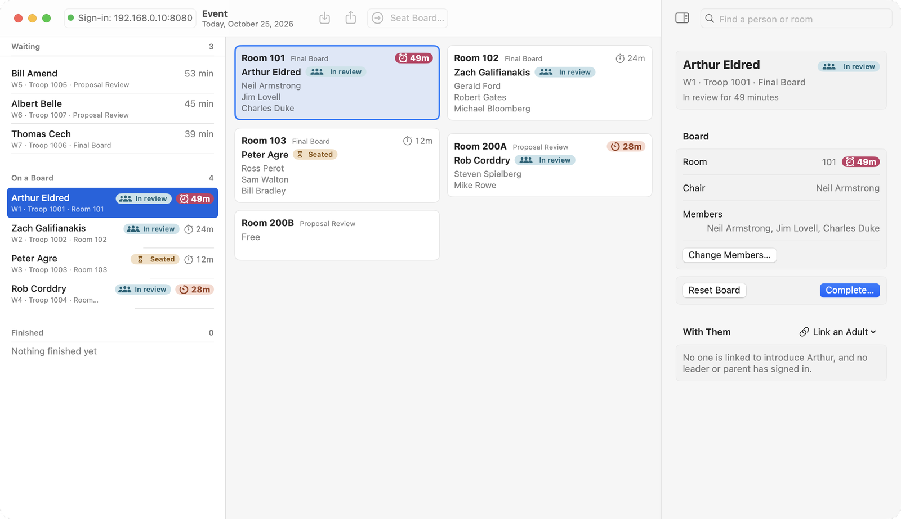
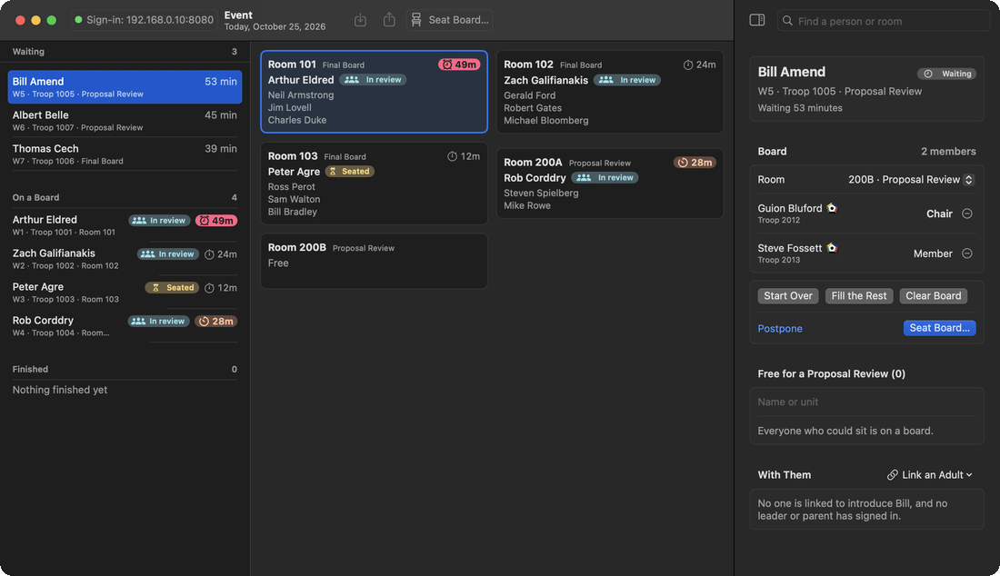

# Eagle Boards

A Mac app for the check-in desk and room assignments on an Eagle Scout board
of review event. Youth and adults sign themselves in on a tablet at the door,
using its web browser. You sit at the Mac, put each youth with a board and a
room, and record the result when they come out.

It runs on one Mac at the event. Check-in needs no internet, only a Wi-Fi
network that the tablet and the Mac are both on. Only the SignUpGenius import
uses the internet (see [SignUpGenius](#signupgenius)).

This is the native Mac version of the Java
[Eagle Board Scheduler](https://github.com/deekayen/eagleboards-java). It reads and
writes the same data files, so a district can switch between them.

<picture>
  <source media="(prefers-color-scheme: dark)" srcset="docs/images/event-dark.png">
  
</picture>

The youth list has three waiting and four on a board. Arthur Eldred's final
board in room 101 is overdue at 49 minutes (an alarm clock on a pink-red fill),
and Rob Corddry's proposal review in 200A is running long at 28 minutes (a
timer on an orange tint). Each room card lists its board's members one per
line, and the inspector shows Arthur Eldred's board, chaired by Neil Armstrong,
ready to complete.

**Running an event? This page is the whole manual.** The same guide is
in the app under **Help › Eagle Boards Help**, with a search field that
**Edit › Find…** (**⌘F**) goes to while Help is in front. Help's **Keyboard
shortcuts** sections list every key the app answers. The pictures use a
made-up event whose cast is famous Eagle Scouts; nothing in them is real.

## Before the first event

You need three things:

1. **A Mac with Apple silicon** (M1 or later) running macOS 15 Sequoia or
   later, with Eagle Boards on it. Intel Macs are not supported, and neither
   is macOS 14, which cannot be tested any more.
2. **A tablet or laptop for the door**, with a web browser, on the same Wi-Fi.
3. **Your room list**: which rooms you have, and whether each is used for
   project proposal reviews or for final boards.

### Getting the app

1. Open the [Releases page](https://github.com/deekayen/eagleboards-macos/releases)
   and, under the newest release's **Assets**, click
   `Eagle-Boards-<version>.zip` (for example `Eagle-Boards-2026.09.28.zip`).
2. Open the zip in your Downloads folder. It unpacks to **Eagle Boards**.
3. Drag **Eagle Boards** to your **Applications** folder, and open it from
   there.

### Opening it the first time

Eagle Boards is signed ad hoc, with no Apple developer account behind the
signature, so macOS cannot say who made it. It is not notarized by Apple
either, so on any other Mac macOS stops it the first time. Opening it takes
two steps:

1. Open the app. macOS says it cannot verify Eagle Boards. Close that message.
2. Open **System Settings › Privacy & Security**, scroll to the Security
   section, click **Open Anyway** beside Eagle Boards, and confirm with your
   password.

Each downloaded copy asks once.

### Tested macOS versions

As of 2026-11-03, GitHub's automated checks run the tests and launch the
built app on macOS 15 and macOS 26. They launch the published zip itself on
macOS 15. The maintainer runs Eagle Boards on macOS 27.

### Choosing the data folder

The first time Eagle Boards opens, it asks where to keep its data. Choose
**Use Documents › Eagle Boards**, or a folder of your own. If you used the
Java Eagle Board Scheduler, choose the folder it ran in, the one holding
`Master_AdultHistory.csv` and the dated folders. Both programs read the same
files. A folder with no `Master_AdultHistory.csv` gets a new, empty one, and
Eagle Boards says where it put it. If you meant another folder, **File › Choose
Data Folder…** switches to it.

That folder holds personal information, some of it about minors. Keep it
private. [Your data](#your-data) says what is kept and where it goes.

## Starting up

Open Eagle Boards. It opens today's event and starts the sign-in station at once.

If macOS asks whether Eagle Boards may accept incoming network connections,
click **Allow**. Otherwise the tablet cannot reach it.

Click the **Sign-in** status in the toolbar. Scan the QR code with the
tablet's camera, or type the address into the tablet's browser. For a second
display or a projector, **Window › Sign-In Code** shows the same code as large
as the window.

The sign-in station serves one network: the Mac's Wi-Fi, unless you choose
another. If the Mac is on more than one network, for example Wi-Fi and
Ethernet, choose the tablet's in **Settings › General › Network**.
**Every Network** also serves any VPN or phone hotspot the Mac is on, and the
**Network** menu shown with the code then picks which network the code is
for. If the network chosen has no address, the station serves another until
it has one, Wi-Fi if it can, and the **Sign-in** status says so. This Mac can
always open the sign-in page itself.

Only the sign-in pages are on the network. The scheduler, the records, and the
settings stay on the Mac, so nobody at the door can look up anyone's details.

## Set up your rooms

Do this before anyone arrives. A board cannot be seated without a room.

Choose **Room › Add Room…** (**⇧⌘N**) and add each room, marking it **Final
Board** or **Proposal Review** by what it is used for today. After the first
event, **Room › Copy Rooms From** brings back an earlier event's list.

To hold two proposal reviews in one room, add it twice, for example `200A` and
`200B`.

Right-click a room card to rename it, move its board to another room, or
change what it is used for.

## The event, step by step

### 1. People sign in

At the tablet, a youth taps **I am a youth** and an adult taps **I am 21 or
older**. Each fills in the form. Youth who pre-registered on SignUpGenius, and
adults who have served before, are recognized by email, and the rest of the
form fills itself in. A youth is never asked for a phone number or a
birthdate.

Each person appears on the Mac the moment they register. Youth are numbered
`P1, P2…` if they pre-registered and `W1, W2…` if they walked in. Pre-registered
youth are listed ahead of walk-ins.

An adult who would rather not use the tablet can be signed in on the Mac:
choose **Adult › Add Adult…** (**⌘N**), or click **Add Adult…** at the foot of
the **Adults** page. Search the adult history to fill the form in for someone
who has served before. On the **Adult History CSV** page, double-click someone, or
select them and choose **Adult › Sign In for Today**, to sign them in for today.

### 2. Check the paperwork

Check each youth's paperwork as they sign in. If it is not in order, select
them and choose **Board › Postpone**. **Edit › Undo** brings them back.

### 3. Seat a board

The **View** menu chooses the page; there is no sidebar. **Event** (**⌘1**)
is where you work: every youth in one list, stacked **Waiting** (in sign-in
order), **On a Board** (by room), and **Finished** (the most recent first), each
with its count, and a card for every room filling the rest of the window, so a
room's timer is never out of sight. Drag the line between them to widen the
list. The inspector follows the selected youth and sits beside the Event page
alone; the other pages are tables, with no inspector.
Click a room card, or Tab to the cards, and the arrow keys move from room to
room; **Return** takes the selected room's next step, as a double-click on its
card does.

**Find a person's room.** Type part of anyone's name, youth or adult, in the
toolbar's search field; **Edit › Find…** (**⌘F**) puts the cursor there. The
room cards narrow to the rooms holding a match, or a room by that name, and a
note at the top of the room cards says where anyone found in no room is (*is
waiting*, *isn't on a board*, *has gone home*, *has finished*, *was
postponed*). **Return** opens the first room found, or the youth. The other
pages are the event's records (see [The records](#the-records)).

Select a waiting youth. Eagle Boards proposes a board in the inspector: a
chair, enough members, and a free room of the right kind. It never picks adults
from the youth's own unit. The member who will chair it reads **Chair**; anyone
else on it who may chair reads **Can Chair**.

Change the board in the inspector: click an adult under **Free for a Final
Board**, or **Free for a Proposal Review**, to add them (**Find an adult**
narrows the list, and **Return** adds the first one) or drag one onto the
board, and the **Remove** button (a minus sign in a circle) takes one off. To
hand the chair to someone who reads **Can Chair**, right-click them and choose
**Make Chair**, or choose them from **Board › Chair**. **Fill the Rest** keeps
who you chose and adds a chair, if none of them can chair it, and members up to
the number needed; **Start Over** replaces the whole board with a proposal.

Until you change it, the proposed board keeps up with the event: when an adult
signs in, goes home, comes back, or leaves a board, it is proposed again.
Choosing its room is not a change, and it stays in the room you chose while
that room is free. Once you take someone off, add someone, use **Fill the
Rest** or **Clear Board**, or make someone else chair, the board is yours,
kept while you look at other youth.

To pick every board yourself, set **Settings › General › When you select a
waiting youth** to **Start with an empty board**. Selecting a youth then picks
only a free room.

Click **Seat Board…** (or press **⌘↩**, or double-click the youth). You can also drag
a waiting youth onto a free room card. The sheet lists anything that stops the board, such as
too few members, no qualified chair, or someone already on another board. It
also lists anything worth a second look, and each of those needs its own tick.
While the sheet is open, the board stays as you are checking it, even if
someone signs in. Choose the chair (the sheet starts with the board's chair from
the inspector) and click **Seat Board**.

The members now have the room and the paperwork. The youth waits outside.

Bill Amend has waited 53 minutes. Selecting him proposes Guion Bluford as chair
with Steve Fossett in room 200B, each with the Wood Badge mark after their
name. The Seat Board sheet confirms it, and room 200B's card shows the board
convening.

### 4. Start the review

When the members have finished reading, select the youth and click **Start
Review** (or press **⌘↩** again). On a board of review, the confirmation names whom to
fetch to introduce the youth to the board, and where they are, even on another
board: the adult linked to them, or if no one is, their leader, never a
parent. A project review has no introduction, so it starts at once, with no
confirmation; **Edit › Undo** takes it back. Throughout the event, the
inspector lists who introduces the youth, then their leader and parents, under
**With Them**; **Board › Locate Leader and Parents** (**⌘L**) scrolls to it.

If the adult introducing a youth did not say so at sign-in, select the youth
and use **Link an Adult** under **With Them**, which lists the adults from the
youth's unit first. To unlink them, right-click them there or choose them from
**Board › Unlink Introducer**.

### 5. Complete

If someone has to leave mid-board, select the youth and click **Change
Members…** in the inspector. It adds or removes members, or hands the chair to
another member qualified to chair, under the same rules as seating. The room's
timer keeps running; it does not restart.

When the board has finished, click **Complete…** (or press **⌘↩**), choose the result,
and add any notes. The room and the members are free for the next board.

Arthur Eldred's board is overdue. The Complete sheet records Approved with a
note, then Arthur Eldred is listed under Finished and room 101 is free again.

## Rules the scheduler keeps

- **Board size.** A final board of review has three to six members (Guide to
  Advancement 8.0.0.3). Three is the norm, four to six asks you to confirm, and
  seven is refused. A project proposal review has two to six.
- **The chair.** Only an adult whose role for that kind of board is **Chair**
  may chair it. When the qualified chairs are all busy, promote someone on the
  **Adults** page. Nobody is made chair by accident.
- **One board at a time.** An adult on a board cannot be put on another.
  **Adult › Mark Gone Home** takes someone out of the pool when they leave,
  and **Adult › Mark Back** brings them back if they return.
- **Same unit.** This council does not allow adults from the youth's own unit
  on the board. You may override that, but a board must still have at least one
  member from outside the unit (8.0.3.0).

## The records

The rest of the **View** menu is a page for each table the event keeps, and
their values are changed in place: click a name, unit, or note to type in it,
or click a value with up and down arrows beside it to choose from a menu. A
change is saved when you press Return or leave the cell. It is not on
**Edit › Undo**, which is for the Event page's steps; change the cell back
instead. Who sits on a board and which room someone is in are never typed in;
they change on the Event page. Nor is a youth's status; it is read-only on
every page, and changes only through the Event page's steps (**Seat Board**,
**Start Review**, **Complete…**, **Postpone**, **Reset Board**, and **Undo**),
which take and free a room and its members. There is no separate records
window. Click a column heading to sort a page by it, or choose
**View › Sort By**; **Return** in the search goes to the first row found.

| Page | What it holds |
| --- | --- |
| **Results** (⌘2) | Every board and its result. Correct a result or its notes here. Double-click a board, or choose **Board › Show on Event Page**, to see it on the Event page. |
| **Adults** (⌘3) | The event's adults. Promote someone to Chair, mark Wood Badge, or fix a name; a change to a name, unit, contact, or role reaches the adult history too. **Add Adult…** at the foot signs someone in by hand. Adults are put on a board on the Event page. |
| **Youth** (⌘4) | Every youth who signed in, in sign-in order. Double-click one, or choose **Board › Show on Event Page**, to see them on the Event page. |
| **Pre-Registered** (⌘5) | The youth who signed up on SignUpGenius for today. |
| **Adult History CSV** (⌘6) | Every adult who has ever signed in, across events, read-only, searched by name, email, or unit. **Last Event** has a check for those signed in today; double-click someone, or choose **Adult › Sign In for Today**, to sign them in. |
| **Rooms** (⌘7) | What each room is used for today, and whose board is in it. Double-click a room, or choose **Show on Event Page** from its right-click menu, to see its card on the Event page. Right-click a room, or select it and choose from the **Room** menu, to **Rename…**, **Move Board to Another Room…**, or set **Used For**. **Add Room…** at the foot adds one. **Room › Remove Room…**, or **Remove Room…** on its right-click menu, removes a free one after asking first, naming the room; **Edit › Undo** puts it back. |
| **Approved Proposals** (⌘8) | Every project proposal approved at an earlier event in the data folder, however long ago, for a youth who comes without the signed page: who, their unit, when, the chair, and the other members. Read only. |

A command works only on a page that shows what it acts on. The inspector and
the **Board** menu's steps, **Locate Leader and Parents** among them, are on the
Event page alone. The **Room** menu works on the Event and Rooms pages, and
**Adult › Mark Gone Home** and **Mark Back** on the Adults page. Everywhere else
those items are dimmed, except **Board › Show on Event Page**, which takes a
youth on Results or Youth to where their board is. **Edit › Undo** and
**Edit › Redo** work from any page. They go to the page that shows what
changed: the Event page for a board or a room (the Rooms page, if you are on
it), or the Adults page for adults marked gone home or back.

To delete a youth, a pre-registration, or an adult, select them and press
**Delete** or choose **Edit › Delete**, or right-click them; that asks first,
since Undo cannot bring them back. **File › Export List…** (⇧⌘E) saves the
page's list as a spreadsheet.

## Room timers

Each busy room shows the minutes since its last step, with a stopwatch. While
a board convenes, it goes overdue after 30 minutes. Once the review starts, a
final board runs long at 30 minutes and is overdue at 45. A proposal review
runs long at 25 and is overdue at 40. Running long is a timer on an orange tint;
overdue is an alarm clock on a solid pink-red fill, so the two differ in shape
and lightness and read with color blindness. They are prompts, not limits.
Change them in **Settings › Timers**. VoiceOver announces a room once as it
turns running long, and again as it turns overdue.

A notification says when a room goes overdue. With Eagle Boards in front, it
goes away after 10 seconds. Behind another app, it stays on screen until you
close it if Eagle Boards is set to **Alerts** in System Settings ›
Notifications; with **Banners** it goes away on its own. **Settings › Timers**
shows the style chosen there; to change it, click **Open System Settings**.

## SignUpGenius

Put the district's SignUpGenius API key in **Settings › SignUpGenius**.
Eagle Boards keeps it in your macOS keychain. When today's event opens, it imports
the sign-up: youth become pre-registrations and adults join the history. Use
**File › Import Sign-Ups from SignUpGenius** to do it again. The import needs
the internet, and is the only thing in Eagle Boards that does; check-in works
without it.

The app is signed ad hoc, so after you install a new version macOS asks once
for access to the key in your keychain. Click **Always Allow**.

## After the event

**File › Export Board Results** saves every board and its result as a
spreadsheet (CSV).
Everything is saved as it happens; there is nothing to save before quitting.

Made a mistake? **Edit › Undo** takes back the last step, whether seating,
starting, completing, postponing, or resetting a board, changing its members,
marking an adult gone home or back, or a change to the rooms from the Event
page. It is refused once the room or a member has been given to another board.

The Dock icon shows how many youth are waiting; the count and the overdue
notification keep going with the scheduler window closed. If you close the
scheduler or the sign-in code, **Window › Scheduler** or **Window › Sign-In
Code** brings it back, and so does the Dock icon's menu (Control-click the
icon). Choosing a page from the **View** menu also brings back the scheduler.

## Your data

Eagle Boards keeps everything in the data folder you chose, as plain CSV files
that the Java Eagle Board Scheduler reads too. Each event has a dated folder
(`2026-11-03`, for example) holding that day's youth, pre-registrations,
adults, and rooms. `Master_AdultHistory.csv` beside those folders keeps every
adult who has signed in, across events.

- What is stored: for a youth, the name, unit, email, unit leader's name, and
  the board's room, members, result, and notes. For an adult, the name, email,
  phone number, unit, board roles, and board history. A youth's birthdate and
  phone number are never asked for or shown, and one already in a file from an
  earlier event stays there, never shown or exported. The SignUpGenius key is in your macOS
  keychain, not in the data folder.
- Where it lives: **Use Documents › Eagle Boards** puts the folder inside
  Documents. When Desktop & Documents Folders is on in iCloud Drive, macOS
  stores Documents in iCloud and makes it available on your other devices. To
  keep the data off iCloud, choose another folder with **Choose…** under Data
  folder in **Settings › General**, or **File › Choose Data Folder…**. Choosing
  a folder does not move the files in the old one, so copy them across first
  if you want them.
- What leaves the Mac: the SignUpGenius import sends your key to
  `api.signupgenius.com` and brings the sign-up's names, emails, units, adults' phone numbers, and unit leaders' names
  back. The sign-in pages travel between the tablet and the Mac over the
  venue's network as plain HTTP, so what a person types there is not
  encrypted on the way; use a network you trust, and quit Eagle Boards when the
  event ends. Eagle Boards itself sends nothing for analytics, crash
  reports, or updates.
- Notifications: a notice that a room is overdue shows the youth's full name
  on screen, and when Eagle Boards is behind another app it can stay in
  Notification Center. If the Mac's screen is projected or shared, turn
  notifications for Eagle Boards off in **System Settings › Notifications**;
  the room cards still show the alarm clock.
- Editing: change the files only through Eagle Boards. The files take no
  quoting, so a spreadsheet that saves one again can add quotes that Eagle
  Boards reads as part of a value, or a comma that it reads as a column
  break, and a row comes out with its columns shifted. The next save writes
  it that way. For a
  spreadsheet, use **File › Export Board Results…** or **File › Export
  List…**, which write new files. An export contains names and, for adults,
  contact details, so keep it private.
- One program at a time: open the data folder in Eagle Boards or the Java
  Eagle Board Scheduler, not both. Nothing locks it, and each save rewrites a
  whole file, so the program that saves last wins.
- Deleting an event: quit Eagle Boards, move that event's dated folder to the
  Trash in Finder, and empty the Trash. The adult history is a separate file
  and keeps its adults, and the Approved Proposals page forgets what that
  folder held. A backup keeps its own copy, and iCloud holds a deleted
  file in Recently Deleted for 30 days.
- Backups and drives: a USB drive or backup holding these files needs its own
  encryption, because the files are plain text. FileVault, in **System Settings
  › Privacy & Security**, encrypts the Mac's startup disk. A Mac with Apple
  silicon already encrypts its storage, and FileVault adds a login password to
  reading it. If you lose both the password and the recovery key, the files are
  lost for good.
- How long to keep them: follow your council's or district's guidance on
  retention.

## If something goes wrong

| Problem | What to do |
| --- | --- |
| The tablet cannot open the address | Check both are on the same network. If the Mac is on more than one, choose the tablet's in **Settings › General › Network**. Check that Eagle Boards is allowed in System Settings › Network › Firewall. |
| "Port 8080 is already in use" | Quit the other program (the Java Eagle Board Scheduler uses 8080 too) and choose **File › Restart Sign-In Station**, or change the port in Settings › General. |
| "None of the members can chair a Final Board" | Add a qualified chair, or promote someone: on the **Adults** page, click their **Final Board Role** or **Proposal Review Role** and choose **Chair**. |
| A board was seated by mistake | Select the youth and choose **Board › Reset Board**, or **Edit › Undo** right after seating. |

## Donating

Eagle Boards is free. If it helps your board events, **Help › Donate…** lists
ways to support its development, with a Venmo QR code a phone can scan.

## For developers

See [CONTRIBUTING.md](CONTRIBUTING.md) for building, testing, and the rules
this code keeps. [SECURITY.md](SECURITY.md) says how to handle participant
data and report a vulnerability. [PROVENANCE.md](PROVENANCE.md) records where
it came from.
Licensed under the Apache License 2.0; see [LICENSE](LICENSE) and
[NOTICE](NOTICE).
